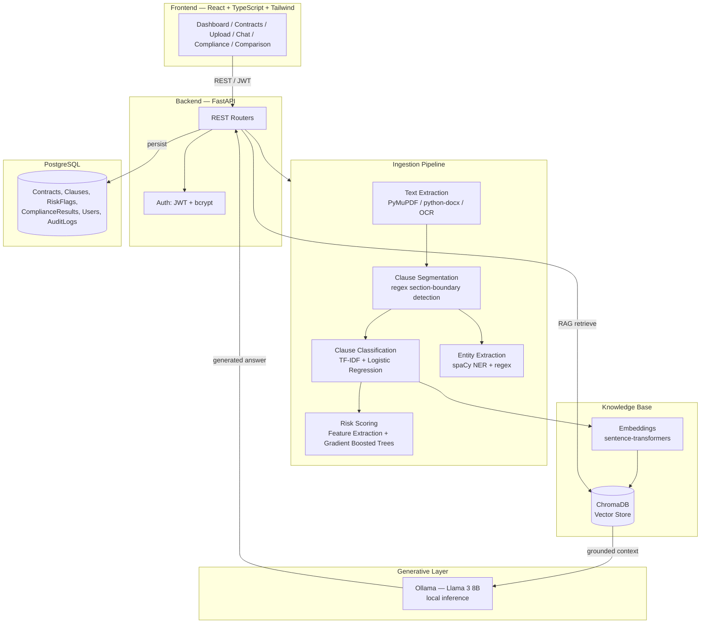

# Covenant — AI Legal Copilot Platform
### Project Report — ML Subject Submission
**Prepared by:** Khushil Parikh

---

## 1. Abstract

Covenant is a full-stack AI-powered contract analysis platform that automates
legal contract review using a combination of classical machine learning,
natural language processing, and retrieval-augmented generation (RAG) over a
locally-hosted large language model. The system ingests PDF/DOCX contracts,
segments them into clauses, classifies each clause using a trained ML model,
scores contractual risk using a second trained ML model, checks compliance
against configurable playbook rules, and supports natural-language
question-answering over the contract's content.

## 2. Problem Statement

Manual contract review is slow, inconsistent, and dependent on scarce legal
expertise. Organizations need a way to surface risk, verify compliance, and
answer questions about contracts quickly and consistently. Covenant addresses
this by automating the repetitive parts of contract review (clause
identification, risk flagging, compliance checking) while keeping a human
reviewer in the loop for final decisions.

## 3. System Architecture

## 4. Machine Learning Methodology

This section documents the two models that satisfy the subject's ML
requirement — both trained, evaluated, and saved as reproducible artifacts
in this repository.

### 4.1 Clause Classification Model

| | |
|---|---|
| **Task** | Multi-class classification — assign each extracted clause to one of 11 legal categories |
| **Classes** | Confidentiality, Termination, Liability, Indemnification, Payment, Intellectual Property, Force Majeure, Non-Compete, Arbitration, Data Privacy, General |
| **Pipeline** | TF-IDF vectorization (unigrams + bigrams, English stop words removed) → Logistic Regression (`class_weight="balanced"`) |
| **Why Logistic Regression** | Outputs calibrated class probabilities directly, which the API surfaces as the "confidence score" the SRS requires (Module 4) — no separate calibration step needed, unlike SVMs or tree ensembles |
| **Training data** | 304 labeled examples, template-generated with randomized party names, time periods, and jurisdictions across the 11 classes, to mimic phrasing variety in real contracts (`data/clause_training_data.csv`) |
| **Split** | 80/20 stratified train/test |
| **Result** | **95.1% test accuracy**; per-class F1 between 0.67–1.00 (weakest class, "General", has the fewest and most heterogeneous examples — expected for a catch-all category) |

### 4.2 Risk Scoring Model

| | |
|---|---|
| **Task** | Regression — predict a 0–100 risk score for a clause |
| **Features** | 9 engineered features extracted from clause text via regex/rule-based NLP: presence of a liability cap, uncapped-liability language, cure period, unilateral ("sole discretion") language, mutuality, survival language, notice period length (days), negligence carve-out, playbook-standard reference — plus the clause's classified type |
| **Pipeline** | One-hot encoding of clause type + engineered features → Gradient Boosted Regression Trees (250 estimators, depth 3) |
| **Why gradient boosting over a fixed formula** | Captures feature interactions (e.g., uncapped liability matters far more when the notice period is also 0) that a hand-tuned weighted-sum formula would need to be manually re-derived for every new interaction |
| **Training data** | 1,200 synthetic rows combining randomized feature combinations with a rule-derived base score plus Gaussian noise (modeling reviewer disagreement) |
| **Result** | **R² = 0.906, MAE = 4.36** risk-score points on held-out data |

### 4.3 Natural Language Processing

- **Entity extraction (Module 2):** spaCy's pretrained NER model (`en_core_web_sm`) extracts dates, organizations, and monetary values; layered with contract-specific regex for fields spaCy has no concept of (governing law clauses, notice-period phrasing, defined-party aliases like `("Client")`).
- **Semantic search (Modules 10, 12):** clause text is embedded with `sentence-transformers/all-MiniLM-L6-v2` and indexed in ChromaDB for nearest-neighbor retrieval — this is what lets a query like *"what happens if we're late on payment"* find a clause about **"Late Fees"** even without exact keyword overlap. A TF-IDF cosine-similarity fallback keeps semantic search functional even before the heavier embedding dependencies are installed.
- **Contract comparison (Module 9):** TF-IDF + cosine similarity matches clauses across two contract versions by content rather than clause number, since renumbering between drafts is common.

### 4.4 Retrieval-Augmented Generation (LLM layer)

Summaries, chat answers, and redline suggestions are generated by a locally
hosted Llama 3 8B model via Ollama — but only ever using clauses retrieved
by the embedding search above. The LLM is never given free rein to
generate contract facts; the system prompt explicitly instructs it to
answer only from retrieved context and cite clause numbers, and the
pipeline falls back to extractive methods (returning the top retrieved
clause directly) if Ollama isn't reachable, so a missing LLM never breaks
the pipeline.

## 5. SRS Module → Implementation Mapping

| SRS Module | Technique | File(s) |
|---|---|---|
| 1. Contract Ingestion | PyMuPDF, python-docx, pytesseract OCR fallback | `app/ml/text_extraction.py` |
| 2. Document Intelligence | spaCy NER + regex | `app/ml/entity_extractor.py` |
| 3. Clause Extraction | Regex section-boundary segmentation | `app/ml/text_extraction.py::segment_into_clauses` |
| 4. Clause Classification | TF-IDF + Logistic Regression | `app/ml/clause_classifier.py`, `train_clause_classifier.py` |
| 5. Contract Summary | RAG via Ollama, extractive fallback | `app/ml/llm_client.py`, `app/services/ingestion_service.py` |
| 6. Compliance Audit Engine | Rule evaluation over engineered features | `app/services/compliance_service.py` |
| 7. AI Risk Assessment | Gradient Boosted Regression Trees | `app/ml/risk_scorer.py`, `train_risk_model.py`, `feature_extraction.py` |
| 8. AI Redlining | RAG via Ollama, structured JSON output | `app/ml/llm_client.py::generate_redline` |
| 9. Contract Comparison | TF-IDF + cosine similarity clause matching | `app/services/comparison_service.py` |
| 10. Contract Knowledge Base | sentence-transformers + ChromaDB | `app/ml/embeddings.py` |
| 11. Chat With Contract | RAG: embedding retrieval + Ollama generation | `app/services/chat_service.py` |
| 12. Clause Search Engine | Semantic (embeddings) + keyword (SQL ILIKE) search | `app/api/routes/search.py` |
| 13. Review Workflow | Status state machine on the Contract model | `app/db/models.py::ReviewStatus`, `app/api/routes/contracts.py` |
| 14. Audit Trail | Append-only action log | `app/db/models.py::AuditLog` |
| 15. Analytics Dashboard | Aggregation queries over stored results | `app/api/routes/dashboard.py` |

## 6. Technology Stack

- **Frontend:** React 18, TypeScript, Tailwind CSS, React Router, Recharts, Vite
- **Backend:** FastAPI, SQLAlchemy, Alembic, PostgreSQL
- **ML/NLP:** scikit-learn, pandas, spaCy, sentence-transformers, ChromaDB
- **LLM:** Ollama (Llama 3 8B), run locally
- **Auth:** JWT (python-jose), bcrypt password hashing (passlib)

## 7. Evaluation Summary

Both models were trained and evaluated within this repository, not just
described — running `python -m app.ml.train_clause_classifier` and
`python -m app.ml.train_risk_model` reproduces:

- Clause classifier: **95.1%** test accuracy across 11 classes (weighted F1 0.95)
- Risk model: **R² = 0.906**, **MAE = 4.36** risk-score points

## 8. Future Enhancements (per SRS Section 8)

Legal research assistant, regulatory monitoring, multi-language contract
support, voice-based interaction, contract negotiation assistant, cloud
deployment, multi-tenant SaaS architecture, CRM/ERP integrations.

## 9. Conclusion

Covenant demonstrates a complete, working application of classical ML
(supervised classification and regression) and NLP (NER, embeddings,
semantic search) to a real business problem, combined responsibly with a
generative LLM layer that is architecturally constrained to only ever
generate text grounded in retrieved source material.
