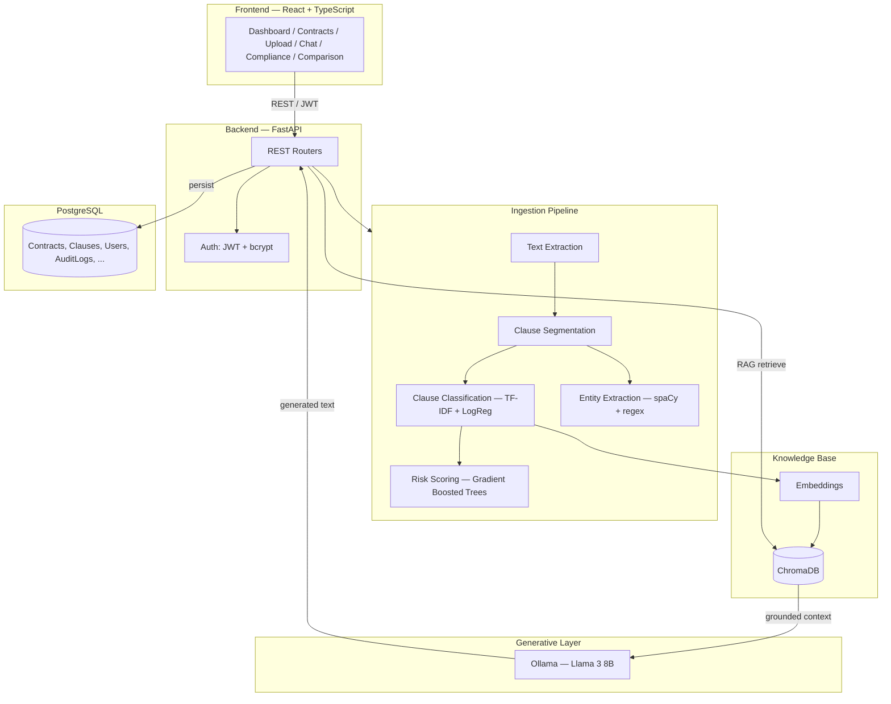

# Covenant — AI Legal Copilot Platform

**An AI-powered contract analysis and compliance management platform** that automates legal contract review using trained machine learning models, NLP, and retrieval-augmented generation over a locally-hosted LLM.

Built as an ML subject project — every "AI" claim in this README is backed by a model that was actually trained and evaluated in this repository, not just described.

---

## Table of Contents

- [Overview](#overview)
- [Features](#features)
- [Machine Learning & NLP](#machine-learning--nlp)
- [Tech Stack](#tech-stack)
- [Architecture](#architecture)
- [Project Structure](#project-structure)
- [Getting Started](#getting-started)
- [Running the Project](#running-the-project)
- [API Overview](#api-overview)
- [Free Tier & Billing](#free-tier--billing)
- [Known Limitations](#known-limitations)
- [Roadmap](#roadmap)
- [License](#license)

---

## Overview

Manual contract review is slow, error-prone, and dependent on scarce legal expertise. Covenant automates the repetitive parts — clause identification, risk flagging, compliance checking, summarization — while keeping a human reviewer in the loop for final decisions.

Upload a contract (PDF or DOCX) and Covenant will:
1. Extract and segment it into individual clauses
2. Classify each clause into one of 11 legal categories using a trained ML model
3. Score each clause's risk using a second trained ML model
4. Extract contract metadata (dates, parties, governing law, payment terms) via NLP
5. Check the contract against configurable compliance playbook rules
6. Generate an executive summary
7. Let you ask natural-language questions about the contract, grounded in its actual clauses
8. Suggest AI redlines for risky clauses
9. Compare two contract versions and highlight what changed
10. Export a full analysis report as a downloadable PDF

## Features

| Module | Description |
|---|---|
| **Contract Ingestion** | PDF/DOCX upload with OCR fallback for scanned documents |
| **Document Intelligence** | Extracts title, dates, parties, governing law, payment terms |
| **Clause Extraction & Classification** | Segments contracts into clauses, classifies into 11 categories with a confidence score |
| **AI Risk Assessment** | 0–100 risk score per clause, with human-readable reasoning |
| **Contract Summary** | AI-generated executive summary of obligations, dates, and risks |
| **Compliance Audit Engine** | Checks clauses against configurable corporate playbook rules |
| **AI Redlining** | Suggests revised clause language for flagged risks |
| **Contract Comparison** | Diffs two contract versions — added, removed, and modified clauses |
| **Chat With Contract** | RAG-based Q&A grounded in the contract's actual extracted clauses |
| **Semantic Search** | Find clauses by meaning, not just keyword |
| **Review Workflow** | Draft → Pending Review → Reviewed → Approved / Rejected |
| **Audit Trail** | Full history of user actions and AI decisions per contract |
| **Analytics Dashboard** | Portfolio-wide risk distribution, clause distribution, compliance rate |
| **Visual Contract Overview** | Plain-language risk gauge, clause-type breakdown, and severity bars on every contract — built for non-technical readers |
| **PDF Report Export** | Downloadable report covering the full analysis of any contract |
| **Auth & Free-Tier Billing** | Sign up, sign in, 30 free uploads, simulated multi-method checkout (see below) |
| **User Profile** | Editable profile details, usage stats, and password change |

## Machine Learning & NLP

This is the part that makes it an ML project, not just a CRUD app with an AI label on it.

### Clause Classification
- **Task:** classify each clause into 1 of 11 categories (Confidentiality, Termination, Liability, Indemnification, Payment, IP, Force Majeure, Non-Compete, Arbitration, Data Privacy, General)
- **Pipeline:** TF-IDF (unigrams + bigrams) → Logistic Regression
- **Why Logistic Regression:** outputs calibrated class probabilities directly, used as the confidence score shown in the UI
- **Result:** **95.1% test accuracy** on a held-out 20% split

### Risk Scoring
- **Task:** regression — predict a 0–100 risk score per clause
- **Features:** 9 engineered features (liability caps, cure periods, unilateral language, notice period length, negligence carve-outs, etc.) extracted via rule-based NLP, plus the clause's classified type
- **Pipeline:** Gradient Boosted Regression Trees (250 estimators)
- **Result:** **R² = 0.906, MAE = 4.36** risk-score points on held-out data

### NLP
- **Entity extraction:** spaCy NER (`en_core_web_sm`) + contract-specific regex for governing law, notice periods, defined-party aliases
- **Semantic search:** `sentence-transformers/all-MiniLM-L6-v2` embeddings indexed in ChromaDB, with a TF-IDF cosine-similarity fallback
- **Contract comparison:** TF-IDF + cosine similarity to match clauses across versions

### Generative layer (RAG)
Summaries, chat answers, and redline suggestions are generated by a **locally-hosted Llama 3 8B** model via Ollama — but only ever using clauses retrieved by the embedding search above. The system prompt explicitly instructs the model to answer only from retrieved context and cite clause numbers, and the pipeline falls back to extractive methods if Ollama isn't running, so the LLM is never a single point of failure.

Full methodology, evaluation details, and the SRS module-to-file mapping are in [`PROJECT_REPORT.md`](./PROJECT_REPORT.md).

## Tech Stack

**Frontend:** React 18, TypeScript, Tailwind CSS, React Router, Recharts, Vite
**Backend:** FastAPI, SQLAlchemy, Alembic, PostgreSQL
**ML/NLP:** scikit-learn, pandas, spaCy, sentence-transformers, ChromaDB
**LLM:** Ollama (Llama 3 8B), run locally
**Auth:** JWT (python-jose), bcrypt password hashing (passlib)
**PDF Generation:** ReportLab

## Architecture



## Project Structure

```
covenant-backend/
  app/
    main.py              FastAPI app + router wiring
    core/                 Settings, JWT/password auth
    db/                   SQLAlchemy models, session, seed script
    ml/                   Classifiers, risk model, NER, embeddings, LLM client, training scripts
    schemas/               Pydantic request/response models
    services/               Business logic (ingestion, compliance, chat, billing, reports)
    api/routes/               REST endpoints, grouped by module
  data/                     Training data generators
  setup.ps1 / run.ps1        One-command setup and start scripts (Windows)

covenant-frontend/
  src/
    pages/                  Dashboard, Contracts, Upload, Chat, Compliance, Comparison, Login
    components/             Shared UI, layout, upgrade modal
    context/                Auth and billing state
    lib/                    API client, TypeScript types
  setup.ps1 / run.ps1

PROJECT_REPORT.md            Full ML methodology + SRS module mapping
```

## Getting Started

### Prerequisites

- **Python 3.11 or 3.12** — not 3.13/3.14, several ML packages don't have prebuilt wheels for those yet
- **Node.js 18+**
- **PostgreSQL**, running locally
- **Ollama** (optional — for LLM-generated summaries/chat/redlining; the app works without it via extractive fallbacks)

### Clone

```bash
git clone https://github.com/YOUR_USERNAME/covenant-ai-legal-copilot.git
cd covenant-ai-legal-copilot
```

### Database

```bash
psql -U postgres -c "CREATE DATABASE covenant;"
```

## Running the Project

### Backend

```powershell
cd covenant-backend
powershell -ExecutionPolicy Bypass -File .\setup.ps1
```

This single script finds a compatible Python version, creates a virtual environment, installs all dependencies, prompts you to set your database password in `.env`, trains both ML models, and seeds the database with a demo account.

Start the server:
```powershell
powershell -ExecutionPolicy Bypass -File .\run.ps1
```
API docs available at `http://localhost:8000/docs`.

### Ollama (optional)

```bash
ollama pull llama3:8b
ollama serve
```

### Frontend

```powershell
cd covenant-frontend
powershell -ExecutionPolicy Bypass -File .\setup.ps1
powershell -ExecutionPolicy Bypass -File .\run.ps1
```
Open `http://localhost:5173`.

### On subsequent runs

Once setup has been done once, starting the app again is just:

```powershell
# Terminal 1
cd covenant-backend
venv\Scripts\activate
powershell -ExecutionPolicy Bypass -File .\run.ps1

# Terminal 2 (optional)
ollama serve

# Terminal 3
cd covenant-frontend
powershell -ExecutionPolicy Bypass -File .\run.ps1
```

Log in with the seeded demo account (`admin@covenant.dev` / `ChangeMe123!`) or register your own.

*Setup instructions above are Windows-focused since that's the primary target environment for this project; on macOS/Linux, replace the `.ps1` scripts with the equivalent shell commands (`python3 -m venv venv`, `source venv/bin/activate`, `pip install -r requirements.txt`, etc.) — the underlying steps are identical.*

Hit an error during setup? Check [`TROUBLESHOOTING.md`](./TROUBLESHOOTING.md) first — it covers every environment issue encountered (and fixed) while building this, with the exact symptom, cause, and fix for each.

## API Overview

Interactive documentation is auto-generated at `/docs` once the backend is running. Key endpoint groups:

| Prefix | Purpose |
|---|---|
| `/api/auth` | Register, login |
| `/api/contracts` | Upload, list, retrieve, update status, export PDF |
| `/api/compliance` | Run and retrieve compliance audits |
| `/api/chat` | Ask questions about a contract |
| `/api/comparison` | Compare two contract versions |
| `/api/search` | Semantic and keyword clause search |
| `/api/redline` | AI-suggested clause revisions |
| `/api/dashboard` | Portfolio analytics |
| `/api/billing` | Usage status and plan upgrade |
| `/api/audit` | Per-contract action history |

## Free Tier & Billing

New accounts get 30 free contract uploads. The sidebar shows live usage; hitting the limit takes you to a checkout page with INR pricing.

**The payment gateway is fully simulated, by design.** This project doesn't integrate with any real payment provider (no Razorpay, no PayPal, no Stripe) — `/checkout` is a self-contained page with its own Card, UPI, Netbanking, and QR Code payment tabs, a simulated "processing" step, and a success/decline outcome, entirely built in-house for demo purposes. No real card, UPI, or bank data is ever transmitted anywhere, no external accounts or API keys are needed, and no real money ever moves.

Test each method with:
| Method | Succeeds with | Declines with |
|---|---|---|
| Card | `4111 1111 1111 1111` (Credit or Debit, any name/future expiry/any CVV) | `4000 0000 0000 0002` |
| UPI | Any ID like `name@bank` | `decline@upi` |
| Netbanking | Any bank in the list | "Test Bank (Always Declines)" |
| QR Code | Always succeeds (no real scan — click "I've completed the payment") | — |

To wire up a real provider later, only one function needs to change — `pay_fake_order()` in `covenant-backend/app/services/billing_service.py` — everything else (upload-limit enforcement, the Payment/AuditLog records, the checkout UI) stays the same.

**If you already ran an earlier version of this project with Razorpay, PayPal, or a single-method fake gateway**, the `payments` table has different columns now (a generic `method`/`detail` pair replacing the old `card_last4` field). Since no real payment data was ever collected, the simplest fix is to drop and let it recreate automatically:
```powershell
psql -U postgres -d covenant -c "DROP TABLE IF EXISTS payments;"
```
Then just restart the backend — it recreates the table with the new schema on startup.

## Profile

Every account has a Profile page (click your name/avatar at the bottom of the sidebar) covering:
- Editable details: full name, company, job title, phone number
- Read-only account info: email, role, plan, member-since date
- Live usage stats (contracts uploaded vs. the free-tier limit, or "unlimited" on Premium)
- Password change (requires the current password, minimum 8 characters for the new one)

**If you already ran an earlier version of this project**, the `users` table needs three new nullable columns for the profile fields:
```powershell
psql -U postgres -d covenant -c "ALTER TABLE users ADD COLUMN IF NOT EXISTS company_name VARCHAR; ALTER TABLE users ADD COLUMN IF NOT EXISTS job_title VARCHAR; ALTER TABLE users ADD COLUMN IF NOT EXISTS phone_number VARCHAR;"
```

## Known Limitations

- ML models are trained on synthetically generated (template-based) labeled data rather than a large corpus of real contracts — accuracy on real-world documents with unusual phrasing may vary. See `PROJECT_REPORT.md` for the full methodology.
- OCR for scanned PDFs requires the Tesseract binary installed separately (`pytesseract` alone isn't enough).
- No real payment gateway integration (by design, for now — see above).
- Windows-focused setup scripts; POSIX shell equivalents aren't included yet.

## Roadmap

- Legal research assistant
- Regulatory monitoring
- Multi-language contract support
- Real payment gateway integration
- Cloud deployment / multi-tenant SaaS architecture
- CRM/ERP integrations

## License

This project was built for educational purposes as part of an ML subject submission. Add a license of your choice here (e.g. MIT) if you intend to open-source it further.
